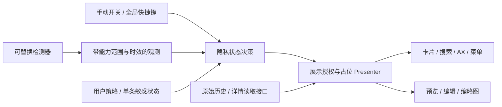

# Whisk May：第一阶段调查与架构审查

调查日期：2026-10-30（Asia/Shanghai）。本报告是调查与规划，不代表已实现的 Whisk May 功能。

## 1. 审查范围与版本

当前工作区 `/Users/LShayc1owN/Desktop/Develop/个人项目/独立/WhiskMay` 在调查开始时为空，不包含 `.git`、应用源码或现有数据库。`git status`、分支和远程查询均返回“不是 Git 仓库”。因此本报告审查的是临时取得的上游版本，不能表述为已经完成本地 fork 初始化。

| 对象 | 固定版本 | 位置与用途 |
| --- | --- | --- |
| Whisk | v1.0.3，`1ebcee1e0735e957777c599017ee411d8046c7e7` | `/private/tmp/whisk-may-audit.XUHzFH/whisk`；完整克隆，HEAD 分支 main，origin 指向上游；审查时 255 个祖先提交 |
| Mica | `88428bec5896c41db4c1267d7a54cd7c03f25f2a` | `/private/tmp/whisk-may-audit.XUHzFH/mica`；只读实现研究 |
| Hush | v0.2.6，`0d71ad9939210bd6325f9fae48cfdcf59f8362c4` | `/private/tmp/whisk-may-audit.XUHzFH/hush`；只读实现研究 |
| Hush 锁定的 Craft | `1fb96b37dc6c30a431570c0902df5aa8a70c911c` | 通过 GitHub API 读取检测相关三个 Zig 文件；未安装或执行运行时 |

以下源码链接固定到这些提交。临时目录可能被系统清理；提交链接和本工作区保存的基线证据是可追溯依据。

本次没有初始化工作区 Git、修改应用源码、提交、推送、创建远程仓库、修改已有远程配置或运行应用主程序。下载源码时 Git 在新建临时克隆中自动生成 origin；这不是为 Whisk May 配置远程。工作区只新增本报告与调查证据。没有读取或迁移用户真实剪贴板数据库，没有执行私有屏幕观察 API。

已阅读 README、`docs/ARCHITECTURE.md`、CONTRIBUTING、CLAUDE、SECURITY、LICENSE、App Store 附加许可、Package.swift、打包和 CI 脚本，以及捕获、存储、搜索、呈现、预览、交互、设置、窗口和相关测试。法文架构文档是镜像文件，本次以英文架构文档和实际源码为准。

## 2. 开发环境与基线

| 项目 | 实测结果 |
| --- | --- |
| 系统 | macOS 15.8.1，build 24H212 |
| 架构 | arm64 / Apple Silicon |
| Xcode | 26.3，build 17C529，选中 `/Applications/Xcode.app/Contents/Developer` |
| macOS SDK | 26.2；没有发现独立的 macOS 15 SDK |
| Swift | Apple Swift 6.2.4，swiftlang-6.2.4.1.4；默认目标 arm64-apple-macosx15.0 |
| Instruments 工具 | `xctrace version 26.0 (17C529)` 可用；未录制实际应用性能 trace |
| 上游包 | tools-version 6.0；Swift 5 语言模式；最低运行系统 macOS 14；没有第三方 Swift Package 依赖 |

最新 SDK 构建与较低 deployment target 并不冲突。本机能构建并运行现有测试，但不能由此声称 macOS 15.0 全版本、新系统、Intel、签名发行包及沙箱发行形态都已验证。上游贡献文档要求 macOS 26 SDK；无需降级 SDK 或升级系统。[Package.swift](https://github.com/nathan-poncet/whisk/blob/1ebcee1e0735e957777c599017ee411d8046c7e7/Package.swift#L7)

| 检查 | 结果 |
| --- | --- |
| `scripts/check-dependency-rule.sh` | 通过：Dependency Rule: OK |
| `swift format lint --strict --recursive Sources Tests Package.swift` | 通过，退出码 0，日志为空 |
| `swift build` | Debug arm64 构建通过，9.34 秒；使用临时缓存路径及 `--disable-sandbox`，没有启动应用 |
| 沙箱内 `swift test --enable-code-coverage` | 309 项、50 个套件，23 个 issue；出现系统服务、私有测试剪贴板、字体、应用查询等沙箱限制，不能直接作为产品失败数 |
| 沙箱外同一测试 | 309 项、50 个套件，304 项通过、5 项失败，共 6 个 issue；Swift Testing 阶段 3.239 秒 |
| 性能 / 能耗 | 尚无 Instruments 数据，不给出空闲 CPU、内存或能源结论 |
| coverage gate | 未通过完整测试，未得到有效的 CI 90% 覆盖率门禁结果；不能引用上游宣称的覆盖率作为本机实测 |

复现命令（在临时 Whisk 克隆中）：

```sh
./scripts/check-dependency-rule.sh
swift format lint --strict --recursive Sources Tests Package.swift
CLANG_MODULE_CACHE_PATH=/private/tmp/whisk-may-audit.XUHzFH/clang-cache \
SWIFTPM_MODULECACHE_OVERRIDE=/private/tmp/whisk-may-audit.XUHzFH/swift-cache \
swift build --disable-sandbox --cache-path /private/tmp/whisk-may-audit.XUHzFH/spm-cache
CLANG_MODULE_CACHE_PATH=/private/tmp/whisk-may-audit.XUHzFH/clang-cache \
SWIFTPM_MODULECACHE_OVERRIDE=/private/tmp/whisk-may-audit.XUHzFH/swift-cache \
swift test --disable-sandbox --cache-path /private/tmp/whisk-may-audit.XUHzFH/spm-cache --enable-code-coverage
```

SwiftPM 的 `--disable-sandbox` 仅关闭包工具自己的沙箱，并未解除外层执行环境的权限限制；正式基线来自经执行环境允许的沙箱外重跑。测试使用随机独立 UserDefaults suite、命名测试剪贴板和临时数据库，不启动 AppDelegate、不注册全局快捷键、不发送 ⌘V。未运行 `swift run`、打包脚本或 `--smoke-test`：上游 smoke test 在返回成功前已打开存储、注册快捷键和启动轮询，不适合尚未隔离身份的开发版本。

失败明细：

| 测试文件与位置 | 观察 | 当前判断 |
| --- | --- | --- |
| `Tests/WhiskTests/HistoryPresenterTests.swift:334` | 期待 `1 item`，实际 `1 items` | 本机真实基线失败；语言回退、资源处理与 Foundation 行为的根因待定位 |
| `Tests/WhiskTests/ClipboardControllerTests.swift:24` | 同样出现 `1 items` | 与上述相关，非新增功能导致 |
| `Tests/WhiskTests/LocalizationTests.swift:83`、`:85` | 单数 item / character 均未走预期复数规则 | 一个测试含两个失败断言 |
| `Tests/WhiskTests/ViewRenderingTests.swift:248` | chip document 宽 868，要求至少 876 | macOS 15 实测布局断言失败；视觉后果待交互验证 |
| `Tests/WhiskTests/ViewRenderingTests.swift:443` | editor 中心 1723，期待 1720±2 | macOS 15 实测布局断言失败；不能直接放宽容差掩盖问题 |

日志保存在本目录下 `evidence/2026-10-30/`：`build.log`、`format.log`、`test-sandboxed.log`、`test-unsandboxed.log`。测试日志开头的 XCTest“0 tests passed”不是最终结论；真正的 Swift Testing 结果在末尾。

## 3. 实际模块地图

上游是一个可执行 Swift module，Clean Architecture 的环通过目录和 import 检查约束，尚未通过独立 target 隔离。建议保持这一组织方式，避免为了新功能立即拆成多个包。[架构规则](https://github.com/nathan-poncet/whisk/blob/1ebcee1e0735e957777c599017ee411d8046c7e7/docs/ARCHITECTURE.md)

下表文件均相对于临时克隆 `/private/tmp/whisk-may-audit.XUHzFH/whisk` 的 `Sources/Whisk/`；不是当前空白工作区已经存在的应用源码。

| 职责 | 实际文件 / 类型 / 函数 | 已确认行为 |
| --- | --- | --- |
| 内容实体 | `Entities/{Payload,ClipboardItem,History,ContentCategory}.swift` | text/link/image/fileReferences；RTF 为 `ClipboardItem.rtf: Data?`；容量、去重、pin 在 History |
| 系统剪贴板 | `Adapters/Gateways/AppKitPasteboard.swift`，`readIfChanged()`、`holdsConcealedContent()` | changeCount；跳过自身写入；敏感类型先过滤；图片 PNG/TIFF；RTF 仅附在 text payload 上 |
| 捕获用例 | `UseCases/CaptureClipboardChange.swift`，`callAsFunction` | 应用排除、recording、保存；排除内容仍消耗该次变化 |
| 编排 | `Adapters/Controllers/ClipboardController.swift`，`pollTick()`、`refresh()` | 保存内存 History、搜索筛选、选中、paste stack、20 层 undo；缓存筛选结果 |
| 轮询 | `App/AppDelegate.swift:170`，`startPolling` | 主 run loop common mode，每 0.25 秒调用 pollTick，无 timer tolerance |
| 存储接口 | `UseCases/Ports/HistoryStore.swift` | 整个数组 `load()` / `save(_:)`，没有分页、增量更新或独立 blob 读取接口 |
| SQLite | `Adapters/Gateways/SQLiteHistoryStore.swift` | 系统 SQLite3；WAL；content 与 ordering；事务保存；完整读回图片及 RTF |
| 存储启动 | `App/HistoryStorage.swift` | 默认 Application Support/Whisk；`WHISK_DATA_DIR`；不可信库移旁、内存降级、旧 JSON 自动迁移 |
| 搜索 | `UseCases/{FilterHistory,FuzzyMatch}.swift`，`ParsedQuery` | 内存扫描与排序；app:/type:/kind:/pinned；非 SQLite FTS |
| 呈现 | `Adapters/Presenters/{HistoryPresenter,HistoryViewState}.swift` | 全部结果转 CardViewState；缓存代码 token 和相对时间；生成含内容的 VoiceOver label |
| 列表 | `App/Views/{HistoryPanelView,ItemCardView}.swift` | HStack 全量 slot + macOS 15 可视窗口挂载；单击粘贴；连续 hover 高亮；contextMenu；图片全结果预热 |
| 大预览 | `App/Views/PreviewOverlayView.swift`、`App/PanelController.swift` | 自建 NSPanel，非 QLPreviewPanel；文字 / 代码 / 图片 / 链接 / 文件摘要；未渲染 RTF |
| 文件 / 链接 | `App/Views/{FileThumbnailStore,FilePreviewView,LinkPreviewStore,LinkPreviewView}.swift` | QLThumbnailGenerator；LPMetadataProvider 联网；进程内共享缓存 |
| 编辑 | `App/Views/EditItemView.swift`、`App/HistoryViewStateStore.swift`、`UseCases/EditItem.swift` | String TextEditor；改写后重新分类并丢弃 RTF |
| 输入与动作 | `App/{PanelWiring,PanelKeyRouter,KeyBindings,VimBindings,MouseActivity}.swift` | 键盘 / 卡片动作接入 controller；搜索 debounce 0.18 秒；窗口预览动作由 router 驱动 |
| 回贴 | `App/PasteSimulator.swift`、`App/PanelController.swift` | nonactivatingPanel 保留原 app 激活；检查 AX 权限后延迟 0.1 秒向当时前台应用发送 ⌘V，没有显式目标 app 校验 |
| 菜单栏 | `App/AppDelegate.swift`，`configureStatusItem()`、`togglePause()` | 一个 NSStatusItem；固定 SF Symbol，暂停直接替换图标；没有图标配置模块 |
| 设置 | `App/GeneralSettings.swift`、`App/Views/SettingsView.swift` | 标准 UserDefaults；容量、保留时长、链接预览、排除应用等；SMAppService 登录项 |
| 测试 | `Tests/WhiskTests/` | 存储 contract、捕获、用例、controller、presenter、offscreen rendering、窗口和设置等 |

## 4. 已确认的问题与性能热点

### 4.1 编辑内容不会正确更新已存在的 SQLite content 行

`History.replacingPayload` 保留 UUID，`EditItem` 调用 `store.save`；但 `SQLiteHistoryStore.insertMissingContent` 对同一 UUID 采用 `INSERT OR IGNORE`。因此内存里已更新的文本和已清除的 RTF 没有写回已有 content 行。[SQLite 源码](https://github.com/nathan-poncet/whisk/blob/1ebcee1e0735e957777c599017ee411d8046c7e7/Sources/Whisk/Adapters/Gateways/SQLiteHistoryStore.swift#L107)、[EditItem](https://github.com/nathan-poncet/whisk/blob/1ebcee1e0735e957777c599017ee411d8046c7e7/Sources/Whisk/UseCases/EditItem.swift#L14)

已用未修改的上游实体、EditItem、SQLite gateway 编译临时独立 probe，写入调查专用数据库并通过新连接读回：

```text
memory: text("after audit edit") rtf: false
reloaded: text("before audit edit") rtf: true
edit survives reload: false
duplicate preserves old RTF: true
```

这是已复现缺陷，不是推测。probe 在 `evidence/2026-10-30/storage-probe.swift`，输出在同名 `.log`。没有改动上游测试或应用源码。现有编辑用例测试用内存 fake，现有存储 contract 没覆盖“同 UUID 内容修改后再次保存”，所以原测试没有捕获此缺陷。后续应补跨 gateway contract、重开连接、undo 和 RTF 清除 / 更新的回归测试，再决定内容 revision 或有条件 upsert；不能以每次重写所有大 BLOB 为默认修复。

### 4.2 去重只比较 payload，会保留旧格式

`History.recording` 以 `$0.payload == payload` 查找重复，重复项只刷新 copiedAt，传入的新 RTF 和 source 被忽略。同纯文本但不同字体 / 颜色的两次复制合并为旧格式。probe 已验证旧 RTF 被保留。[History.swift:17](https://github.com/nathan-poncet/whisk/blob/1ebcee1e0735e957777c599017ee411d8046c7e7/Sources/Whisk/Entities/History.swift#L17)

富文本功能前必须明确去重语义：同正文但不同 RTF 是否视为不同记录，或刷新同记录的格式；原始 RTF 字节差异未必代表视觉差异，不宜贸然做昂贵的全量格式规范化。

### 4.3 上游已有私有视觉实现

`App/Views/GlassEffects.swift` 中 `BackdropBlurTuner.tune` 动态寻找 `CAFilter`、执行 `filterWithType:`，并依赖内部 backdrop layer 结构。函数叫 `liquidGlass` 并不证明使用稳定的 SwiftUI Liquid Glass API。后续 Native First 应采用公开 `NSVisualEffectView` / 系统 material，移除这段内部依赖；本阶段仅记录。[GlassEffects.swift:131](https://github.com/nathan-poncet/whisk/blob/1ebcee1e0735e957777c599017ee411d8046c7e7/Sources/Whisk/App/Views/GlassEffects.swift#L131)

### 4.4 性能与生命周期

| 位置 | 源码证据 / 风险 | 后续测量或候选改动 |
| --- | --- | --- |
| 剪贴板轮询 | 4 Hz 主线程 timer；无变化时 changeCount 阻止读 payload 和存储，controller 不反复发布相同 history；暂停时仍 `readIfChanged()`，会读取变化内容后丢弃 | 先测 idle wakeups；评估变化计数消费接口、timer tolerance、睡眠 / 唤醒；不可假设存在通用公开变更通知 |
| SQLite 访问 | `load()` 取全部 BLOB；启动 `openReadable` 先完整读一次，controller 加载时再读一次；同步保存经主线程轮询链执行，busy_timeout 最长 2 秒 | 测启动峰值 / 主线程阻塞；后续考虑单次可信加载、按 revision 保存、串行 I/O adapter |
| 每次保存 | 遍历全部 item 并为既有项绑定 BLOB，虽 `INSERT OR IGNORE` 不重复持久化 content，但 `SQLITE_TRANSIENT` 绑定仍有复制工作；ordering 全删重建，content 清理 | 以历史数量和图片体积做规模测试；增量接口需要重构 port，而非只换 SQL |
| 列表与分页 | macOS 15 已按滚动窗口挂载重卡片，但所有 slot、History、CardViewState 都仍在内存；不是数据库分页 | 保留已有视图窗口机制；分页放在测量证明必要之后，需处理搜索、pin、排序、选中、undo 和 stack |
| 图片预热 | `ItemCardView.prewarm(cards)` 遍历全部结果并排队解码，不限于挂载区域；NSCache countLimit 512、480 px 缩略图，没有 costLimit / 取消 / 排队去重集合 | 可视范围 + 少量预取、任务取消、像素成本预算；NSCache 上限不等于固定内存承诺 |
| 大图预览 | `PreviewOverlayView` body 内 `NSImage(data:)`；隐藏预览只 orderOut，panel / hosting root 被长期保留 | 测重复打开大图和关闭后的 retained graph；按需求释放 preview session，不强制销毁所有窗口 |
| Presenter | 遍历全部筛选结果，代码 token、完整正文、AX 摘要；缓存 limit 2048 时保留 presentedIDs，若当前结果超过上限可继续增长 | 轻量摘要与详情分离；不要把 NSAttributedString 放进每张卡片 |
| 链接缓存 | `LinkPreviewStore` 512 项到顶清空；图片非按字节预算；本地 provider 无集中取消句柄；禁用仅阻止新请求和展示，已进行请求仍可能完成 | 限制图片尺寸、代际校验、可取消 fetch；敏感内容完全禁止该路径；评估框架自身网络缓存 |
| 文件缩略图 | `FileThumbnailStore` 失败时直接 return，未从 inFlight 移除 path；无重试 / 取消，计数缓存清空；系统服务是否写磁盘未验证 | 修正生命周期策略；临时敏感内容绕过 Quick Look，不宣称仅因 Swift 字典在内存就无磁盘副作用 |
| Undo | 保存最多 20 个 History；Data 的值语义允许共享底层存储，不能声称必然 20 倍内存，但被删内容可被 undo / presenter / 缓存继续持有 | 敏感会话单独 TTL、禁止进入普通 undo；用 Allocations 看实际 retention |
| 事件监视 | PanelController.deinit 仅移除 screenObserver，未 remove mouseMonitor；拖拽 timers 的 deinit 清理不完整；AppDelegate 的长期 timer / layout observer 无统一 stop | 目前 app lifetime 存活不能直接称为增长性泄漏；后续需要幂等 start/stop、窗口销毁与重复创建测试 |
| Combine / Task | 当前主要是 AnyCancellable、DispatchQueue、Timer、completion，未发现大量 Swift concurrency Task；订阅多用 weak self，HotKey 有 deinit 释放 | 新检测器与 RTF preview task 需要明确 owner、cancel、generation 和停止行为，不能机械添加常驻 task |

主要证据：[ItemCardView.swift:297](https://github.com/nathan-poncet/whisk/blob/1ebcee1e0735e957777c599017ee411d8046c7e7/Sources/Whisk/App/Views/ItemCardView.swift#L297)、[HistoryPanelView.swift:97](https://github.com/nathan-poncet/whisk/blob/1ebcee1e0735e957777c599017ee411d8046c7e7/Sources/Whisk/App/Views/HistoryPanelView.swift#L97)、[HistoryStorage.swift:76](https://github.com/nathan-poncet/whisk/blob/1ebcee1e0735e957777c599017ee411d8046c7e7/Sources/Whisk/App/HistoryStorage.swift#L76)、[PanelController.swift:100](https://github.com/nathan-poncet/whisk/blob/1ebcee1e0735e957777c599017ee411d8046c7e7/Sources/Whisk/App/PanelController.swift#L100)。这些是待测热点；不是本阶段已经测得的资源消耗。

## 5. 功能可行性与实施边界

### 5.1 完整 RTF 预览与编辑

可直接复用 `ClipboardItem.rtf`、SQLite rtf BLOB 与现有回贴。当前 `CardViewState` 没有 RTF，`PreviewOverlayView` 展示 plain Text / CodeTextView；现有“完整预览”不是富文本排版。AppKitPasteboard 只在 payload 为 text 时取 RTF；只有 RTF 无 plain string、富文本被判为纯 URL、RTFD / HTML 等情况没有完整保留承诺。文件大预览也复用了最多四个文件名的 card summary，并非所有文件的完整详情。[PreviewOverlayView.swift:44](https://github.com/nathan-poncet/whisk/blob/1ebcee1e0735e957777c599017ee411d8046c7e7/Sources/Whisk/App/Views/PreviewOverlayView.swift#L44)

建议新增按选中 ID 取详情的 `PreviewSession` 与 `RichTextCodec`，通过 `NSViewRepresentable` 承载 NSTextView / NSScrollView。只读时 rich text 可选择但不可编辑；编辑时保留属性并原子保存 plain text 与 RTF。AppKit 类型留在外环，用例只传 Data / String。对格式损坏 / 超大内容使用限额和纯文本 fallback；RTF 附件、字体缺失、外链点击及附件读取策略须显式处理。不能承诺跨应用字体和所有段落特性完全保真。

详情请求必须经过展示授权并支持取消，列表不解析全量 RTF；编辑草稿不写自动恢复文件或临时 RTF。先修复编辑持久化和格式去重，再增加富文本编辑，避免扩大数据一致性缺陷。

### 5.2 可配置卡片交互

已有 select / copy / edit / preview / menu 接点，但没有统一的手势策略。`ItemCardView` 目前 `.onTapGesture` 立即粘贴、连续 hover 仅高亮、contextMenu 固定存在；预览 toggle 在 PanelController 的私有函数中，卡片 PanelActions 尚无按 ID 预览动作。[ItemCardView.swift:69](https://github.com/nathan-poncet/whisk/blob/1ebcee1e0735e957777c599017ee411d8046c7e7/Sources/Whisk/App/Views/ItemCardView.swift#L69)

建议配置模型 `CardTrigger` / `CardAction` / `InteractionBindings`；AppKit 事件 adapter 与 `CardInteractionCoordinator` 将手势解释成现有 PanelActions。若单双击配置不同，第一击必须等待系统 `NSEvent.doubleClickInterval` 或使用已验证的互斥识别器；双击取消待执行单击，不能第一击先回贴再打开预览。卡片删除、面板关闭、拖拽开始和隐私状态变化都要取消挂起动作。

hover 采用可取消停留时间和“每次进入最多触发一次”，不要把现有连续 movement 事件直接映射为反复粘贴。允许用户显式选择 hover 粘贴，但默认保持安全的非副作用行为；hover 不触发 AX 权限弹窗。

右键可配置后仍需固定的“更多”按钮、键盘入口和 VoiceOver named action，确保操作菜单及临时显示始终可达。禁止把右键配置成某个动作后彻底移除菜单唯一入口。

`PasteSimulator` 的 0.1 秒延迟只向当时前台 app 注入，并没有记录原 app。新预览 / 编辑窗口可能改变激活关系；应新增 `PasteTargetSession` / `PasteCoordinator`，在面板打开前记住原应用、恢复并确认目标后再回贴，目标退出或切换竞态时取消自动粘贴并保留已复制内容。无 AX 权限应提供“已复制，可手动粘贴”的结果状态。AX 授权属于回贴，不应成为单纯复制和预览的门槛。[PasteSimulator.swift:11](https://github.com/nathan-poncet/whisk/blob/1ebcee1e0735e957777c599017ee411d8046c7e7/Sources/Whisk/App/PasteSimulator.swift#L11)

### 5.3 自定义菜单栏图标

SF Symbol 支持属于小范围扩展：将图标选择存入独立设置，校验该符号在 macOS 15 可用，失败回退；复用现有 statusItem，仅更新 button.image；显式采用 template image。暂停与隐私状态应由同一图标 renderer 组合处理，否则 `togglePause` 会覆盖自选图标。[AppDelegate.swift:178](https://github.com/nathan-poncet/whisk/blob/1ebcee1e0735e957777c599017ee411d8046c7e7/Sources/Whisk/App/AppDelegate.swift#L178)

导入自定义图标是后续独立任务：通过 NSOpenPanel 复制到 Whisk May 专用资源目录，规范尺寸 / 像素 / alpha、限制文件大小和类型；默认模板单色并预览明暗状态。彩色 bitmap 设 template 并不会自动变成优质轮廓，必要时明确选择单色模板或原色模式。避免引用任意长期失效路径；移除 / 替换导入文件和退出时释放资源。验收用反复切换和 NSStatusItem 数量 / retain graph，不靠肉眼判断没有泄漏。

### 5.4 敏感内容保护

上游在读取 payload 前跳过 `org.nspasteboard.ConcealedType`、`TransientType`、`AutoGeneratedType`，不是靠识别密码文字。必须保留为最高优先级 hard reject，不能让用户的“临时保留”选项覆盖明确的不可记录标记。密码管理器未设置标记时，没有普遍可靠的密码识别保证。[AppKitPasteboard.swift:7](https://github.com/nathan-poncet/whisk/blob/1ebcee1e0735e957777c599017ee411d8046c7e7/Sources/Whisk/Adapters/Gateways/AppKitPasteboard.swift#L7)

建议将策略明确拆为：拒绝记录、用户规则选中的仅内存短期保留、普通持久化；“默认打码”本身不是持久化策略。`SensitiveContentPolicy` 在产生历史 / undo / 缓存 / 日志之前分类；原始禁止标记不必将秘密 Data 暴露给内核。来源应用过滤目前在 payload 读取后，若追求更保守策略可在 adapter 层先做来源判断，并处理 pasteboard 归属采样的竞态。

临时敏感项需要专用 `EphemeralHistoryStore` / session vault：TTL、关闭 / 锁屏 / 退出重隐藏或清除；不能只选用现有 VolatileHistoryStore 替换整个普通数据库来假装实现混合策略。任何批量 save、pin、编辑、undo、导出、缩略图及链接 metadata 路径都不得将其旁路写入普通库。Swift / AppKit 无法保证所有 Data 副本或系统 swap 都被安全抹零，产品只承诺减少不必要持久化，不宣传绝对内存保密。

`RevealSession` 通过右键菜单 / 可达的更多菜单显式显示，到期、失焦、锁屏、共享遮盖生效时立即重新隐藏。全局隐私模式优先于单条临时显示，不能右键绕过共享遮盖。保护态 AX 内容、tooltip、文件名和链接必须同样替换；不能只对视图做 blur。

## 6. 屏幕共享检测研究

### 6.1 Mica：私有 WindowServer 观察信号

实际实现是 [ScreenCaptureMonitor.swift](https://github.com/Vedant-29/mica/blob/88428bec5896c41db4c1267d7a54cd7c03f25f2a/Sources/MicaCore/Monitors/ScreenCaptureMonitor.swift#L35)：

- 用 `dlsym` 查 `CGSIsScreenWatcherPresent` / `SLSIsScreenWatcherPresent`，通过无参数函数返回布尔。
- 另查 `CGSRegisterNotifyProc` / `SLSRegisterNotifyProc`，订阅硬编码的 1502 / 1503 事件；通知只作为重新查询提示。
- 2 秒轮询作为补偿，tolerance 0.5 秒；回调切回 main actor。
- 缺符号则声明不支持；stop 清 timer，但没有对应的通知注销，shared singleton 只指向一个 monitor；重复 start 的幂等性和多实例生命周期不能直接复用。
- `CaptureAttribution.likelyCapturer()` 只猜测来源，不控制是否保护；“OBS 在运行”不应被当作录制证据。

项目注释将该布尔解释为 WindowServer 的捕获流观察者计数是否非零，与系统录制提示关联。这是参考项目对私有行为的解释，不是 Apple 的公开契约，也不是本次通过 WindowServer 逆向验证的机制。该 API 不提供捕获者、屏幕 / 窗口 / tab、共享范围、是否网络发送、是否实际捕获 Whisk May 或计数值。

Mica 的 Package.swift 声明 macOS 15，证明作者有以 15 为目标的设计，不能证明每个 15.x 与所有软件组合都兼容。本阶段没有调用该私有 API，没有启动 Mica，也没有在共享 / 录制场景验证布尔变化、ABI、回调或通知语义；这些均为待验证。即使符号存在，也不足以证明运行可靠。参考项目承认某些 Apple 内部捕获不计入此状态；硬件采集和摄像头拍屏不在检测范围。

**结论：仅保留研究记录及可替换接口；不集成 CGS/SLS 探测、私有事件编号或 dlsym wrapper。任何实际实验实现也应先由用户单独确认。**

### 6.2 Hush / Craft：多个启发式信号

Hush 本身通过 `@stacksjs/desktop/browser` 的 `screenSharing.getState()`、`watchScreenSharing()` 接入检测；默认 2 秒采样，Focus 开启延迟 1 秒、关闭延迟 5 秒，policy 与 runtime 分离。不能只读 Hush README 就说已验证原生实现。[Hush controller](https://github.com/stacksjs/hush/blob/0d71ad9939210bd6325f9fae48cfdcf59f8362c4/src/runtime/controller.ts#L97)、[policy](https://github.com/stacksjs/hush/blob/0d71ad9939210bd6325f9fae48cfdcf59f8362c4/src/core/policy.ts#L20)

本次追到 pantry.json 固定的 Craft 提交，检查了：

- [screen_sharing.zig](https://github.com/home-lang/craft/blob/1fb96b37dc6c30a431570c0902df5aa8a70c911c/packages/zig/src/screen_sharing.zig)：窗口 owner / 标题规则，系统共享、remote、会议、录屏四种来源及 digest。
- [bridge_screen_sharing.zig](https://github.com/home-lang/craft/blob/1fb96b37dc6c30a431570c0902df5aa8a70c911c/packages/zig/src/bridge_screen_sharing.zig#L135)：会话字典、获准后读取 CGWindowListCopyWindowInfo、AX 适配器；worker 串行查询；NSTimer common mode；无变化不投递新事件；generation 排除旧回调；stop 取消 timer 和后台 activity。
- [sharing_accessibility.zig](https://github.com/home-lang/craft/blob/1fb96b37dc6c30a431570c0902df5aa8a70c911c/packages/zig/src/sharing_accessibility.zig#L16)：仅查询指定 bundle ID 的 Chrome、Dia、Discord、Slack；每次 AX IPC timeout 0.05 秒、每个目标应用约 750 ms 预算、限制窗口 / 节点 / 遍历深度；匹配 app 自身 banner / toolbar，避免网页文字冒充；读失败为 incomplete，而不是停止共享。

**公开 API 与不稳定行为必须分开：**

1. `CGSessionCopyCurrentDictionary()` 是公开函数；Craft 使用的字符串键 `CGSSessionScreenIsShared` 未出现在本机公开 CoreGraphics/CGSession.h，也未找到 Apple 公开契约。应归为未文档化实验性信号，不能作为“仅公开 API”方案的稳定核心。
2. SDK 的公开宏 `kCGSessionOnConsoleKey` 对应字符串 `kCGSSessionOnConsoleKey`，只表示会话是否在 console；不等价于“正在录制”或“远程观看者正在看到内容”。离开 console 不足以判定共享。
3. `CGWindowListCopyWindowInfo` 是公开 API，但窗口标题需相应授权，英文 substring、owner 为空的泛匹配和应用版本都带误报 / 漏报风险。Screen Sharing 查看端窗口存在，不一定等于本机画面向外发送；QuickTime 的“Screen Recording”窗口、截图工具 UI 出现也可能只是准备态。
4. AX 是公开且需用户授权的 API，但共享控件结构 / 文本没有统一跨应用规范。语言、客户端升级、隐藏 toolbar、窗口重建、后台 tab、权限撤销均会影响结果；不能把“没有匹配到”显示为所有软件均未共享。
5. Craft 为持续检测持有 background activity，且每次可能进行 AX 遍历；源码注释的“约 1 ms / negligible”并未在本机验证，不能套用为 Whisk May 的能耗结论。

Hush 的 policy 服务于 Focus，带 1 秒开启延迟及手动开启后共享结束可清除的语义；这不适合直接照搬到剪贴板隐私模式。隐私应尽快遮盖，延后解除，并独立保持用户手动开启状态。

Hush package.json 声明 MIT，但该提交未发现独立 LICENSE 文件；本阶段只借鉴设计，不复制代码。若以后复制 Hush / Craft 的实现，需逐项目补查完整许可和依赖，不把 Hush 的 MIT 声明自动套给运行时。

### 6.3 系统限制与来源分类

| 场景 | 能观测的线索 | 局限 / 待验证 |
| --- | --- | --- |
| 系统 Screen Sharing / ARD | 部分会话与 UI 信号，实验性 WindowServer probe | 会话方向、console 含义、系统内部流；不能只看进程存在 |
| 第三方远程桌面 | 可能有自己的窗口或 AX 控件 | 不一定更改系统 session 字典，不一定使用被计数的捕获路径 |
| 本地录屏：QuickTime、⌘⇧5、OBS 等 | 特定录制 UI；实验性观察者信号 | 录制准备不等于录制；OBS 打开不等于正在录制；可能后台无 UI |
| 会议共享整个屏幕 / 窗口 | app 或浏览器的共享 toolbar、AX 控件 | UI 更新 / 本地化 / 最小化会失效；共享其他窗口仍可保守遮盖全部 Whisk 内容 |
| 浏览器仅共享 tab | browser 自身 AX banner 有时可见 | 可能不经常规屏幕观察路径，WindowServer 不足以覆盖；网页内文本不应当作可信证据 |
| AirPlay / 镜像 / 硬件采集 | 某些公开显示配置只说明镜像或连接 | 无法推导所有真实观看 / 采集，硬件采集或外部相机无法通过这些 detector 解决 |

Apple 的 [ScreenCaptureKit](https://developer.apple.com/documentation/screencapturekit) 用于创建和管理本应用捕获；`SCShareableContent` 不提供全系统其他应用的活跃捕获列表。`CGPreflightScreenCaptureAccess` 是权限预检，不是“正在录制”状态。`CGDisplayIsCaptured` 属于显示独占 capture 语义，不能代替现代录屏 / 共享检测。[Quartz Display Services](https://developer.apple.com/documentation/coregraphics/quartz-display-services)

本机 26.2 SDK 中 SwiftUI `isSceneCaptured` 对 macOS 标记 unavailable，不能把 iOS / visionOS API 用在 macOS 15。`NSWindow.sharingType` 即使设为 none 也不应被宣传为跨现代捕获路径可靠防录屏；本阶段没有验证其对实际客户端的效果，主方案应直接不渲染原内容。

### 6.4 事件、轮询与状态抖动

建议公开实现利用 NSWorkspace 应用启动 / 终止、会话与唤醒事件缩小候选集，对明确支持通知的 AX 属性使用 AXObserver；应用不发通知或权限不可用时，低频轮询作补偿。AX 通知不是通用共享开始 / 结束通知。轮询候选区间 2–5 秒应作为测量参数，不是性能结论；无候选应用、功能关闭、睡眠时减少 / 停止检查，唤醒或新候选出现时立即重查。

工作线程做有时间预算、节点上限、可取消的串行检查；不积压 timer task、不阻塞主线程，不保留无关窗口标题。输出变化才发布，记录信号类型 / 耗时 / 错误码即可，不记录正文、路径或完整会议窗口标题。

确认 positive 后尽快遮盖；解除需要持续稳定的 clear（初始可试 3–5 秒）且所有已知 active 来源均已结束；一个来源停止不得覆盖另一个仍 active 的来源。AX timeout、权限撤销、unsupported、读不到 session 均是 unknown，不是 clear。保护已开启后遇 unknown 保持遮盖并说明“检测不可用，暂保持遮盖”；初始 unknown 可保守遮盖，界面说明是预防措施。采样与渲染有时延，无法保证共享开始前第一帧绝不泄露；重要会议应在共享前手动开启。

## 7. 建议模块边界（尚未实施）

保留内核 Foundation only、用例同步决策、外环负责 Timer / AX / Actor / AppKit 的规则。

| 层 | 建议类型 / 文件 | 边界 |
| --- | --- | --- |
| Entities | `CaptureObservation.swift`、`PrivacyState.swift`、`SensitiveContentPolicy.swift`、`InteractionBindings.swift` | 无 AppKit；定义 active / clearWithinCoverage / unknown、来源、范围、时效、手动开关、内容策略和手势映射 |
| Ports | `ScreenSharingDetector.swift`、`PreviewContentSource.swift`、必要时 `EphemeralContentStore.swift` | 返回 Foundation 值；检测能力及权限状态独立表达；每项 detector 命名支持范围；敏感数据存储与普通 HistoryStore 隔离 |
| UseCases | `EvaluatePrivacyState.swift`、`AuthorizeContentPresentation.swift`、`EditRichTextItem.swift` | 接收 now、旧状态和观测，纯同步 reducer；原子更新 plain+RTF；仅决定策略，不调用系统 API |
| Adapters/Controllers | `PrivacyController.swift`、`CardInteractionCoordinator.swift` | 合并手动和自动输入；输出 presentation policy；动作优先级与取消；不持有 SwiftUI view |
| Adapters/Presenters | `PrivacyPresenter.swift`，修改 `HistoryPresenter` / `HistoryViewState` | 生成不带可识别内容的占位状态与 AX 文本；卡片 DTO 轻量化；详情按 ID 授权读取 |
| App drivers | `ScreenSharingMonitor.swift`、`AccessibilitySharingDetector.swift`、`WindowIndicatorDetector.swift` | 公开 API、受限启发式、权限分离；生命周期、worker、timeout、低频 timer；不将未知归为未共享 |
| App drivers | `PrivacyStateStore.swift`、`PreviewSession.swift`、`RichTextCodec.swift`、`RichTextPreviewView.swift` | 主线程 UI 状态、RTF 按需解析、NSTextView；隐私切换立即销毁可识别视图子树 / 取消旧请求 |
| App drivers | `PasteCoordinator.swift`、`StatusItemIconController.swift`、`AppIdentity.swift` | 目标 app、AX 与回贴；单个 NSStatusItem 更新；独立身份、路径和 defaults 注入 |
| 实验范围 | 将来可选的 `ExperimentalWindowServerDetector` | 仅设计占位；用户单独确认前不实现、不链接、不动态解析私有 API，也不把它混入公开方案 |



检测结果至少带 `providerID`、稳定来源 token、kind / scope、observedAt、freshness、coverage、permission、health。不要用一个全局 Bool 同时表达“无权限”“没有观测到”和“已确认结束”。观察器不能写数据库，也不能改变手动开关。

隐私状态管理器保存两个独立概念：

```text
manualProtection: on/off（持久化，只有用户动作修改）
automaticPreference: enabled/disabled（持久化）
automaticProtection: active/clear/pendingClear/unknown（运行时、含 freshness）
effectiveMask = manualProtection OR
                (automaticPreference AND automaticPolicyRequiresMask)
```

关闭 manualProtection 只移除手动原因；自动保护仍有效时应继续遮盖并清晰说明。关闭 automaticPreference 不得清除 manualProtection。重启不保存上次“检测到共享”作为当前事实，应先按初始化 unknown 策略处理；手动保护偏好先于历史视图渲染加载，避免启动闪现。

单条敏感 reveal 是另一个独立、短期的状态：全局 mask 优先于 reveal。提示文案区分“内容已隐藏（手动）”“检测到支持范围内的共享线索，内容已隐藏”“检测状态未知，内容已隐藏 / 自动检测不可用”。“没有观测到共享”不得表述为“所有软件都未录屏”。

展示边界必须同时处理：

- 卡片正文、RTF、图片、颜色、链接地址和 metadata、文件名 / 路径 / 缩略图、来源 app 信息等可识别数据。
- 搜索栏中用户输入的秘密、匹配高亮、结果摘要、数量 / 筛选信息的侧信道；建议全局 mask 时隐藏查询显示并暂停内容搜索，内部 query 可保留以便恢复。
- 详情 panel、现有文件摘要与将来 Quick Look / QLPreviewPanel、编辑器草稿、链接点击、文件 reveal / export。
- AX label / value / hint / named action、tooltip / help、context menu 标题、状态栏 tooltip、通知和日志。
- drag provider 及系统拖拽快照。保护态禁用泄露数据的拖拽、编辑和打开外部预览；copy / paste 如仍允许，应属于显式动作策略，不能由 hover 意外触发。
- 已在飞行的 LP / QL / RTF 异步结果：取消或以 privacy generation 丢弃，不准旧 completion 在遮盖后重建可识别子树；退出隐私时重新授权加载。

应使用明确的 placeholder view state / 轻量受限 DTO，将 raw dragPayload 和 detail accessor 从保护态 view 隔离。SwiftUI `.redacted`、透明度、blur 或上覆一个矩形都不能独自满足这些要求。原始 History 不因遮盖变更，数据库不保存占位文本。

## 8. 许可、素材与仓库策略

所选 v1.0.3 适用 **GPL-3.0-or-later + App Store 附加许可**。旧 v0.4.0 的 LICENSE 已通过 Git 对照为 MIT，但这不能用于许可包含 v1.0.3 新代码的派生版本。[LICENSE](https://github.com/nathan-poncet/whisk/blob/1ebcee1e0735e957777c599017ee411d8046c7e7/LICENSE)、[附加许可](https://github.com/nathan-poncet/whisk/blob/1ebcee1e0735e957777c599017ee411d8046c7e7/LICENSE-EXCEPTION-APP-STORE.md)

正式初始化时应保留上游许可证、Nathan Poncet 版权及附加许可正文；增加 Whisk May 的修改说明、修改日期和自身版权，不替换上游署名。发行 GPL 二进制时需提供该二进制对应的完整源码及必要构建脚本、许可证与相应声明，不能只链接尚未包含 May 修改的上游仓库。App Store / TestFlight 的附加许可没有把派生作品变为闭源，也没有豁免其他第三方义务；新增贡献与依赖若要继续适用商店例外，应检查其授权是否允许。非商店发行遵循 GPL；商业售卖并不被 GPL 禁止。[GNU GPL FAQ](https://www.gnu.org/licenses/gpl-faq.en.html)

`Package.swift` 当前没有外部依赖，AppKit / Foundation / SQLite3 由系统提供；没有发现 vendored Swift 依赖或第三方字体包。这不是对所有素材来源和全部代码 provenance 的全面保证。`PasteSimulator` 注释提到 Flycut / Maccy 技巧，注释本身不足以判断是否复制了受许可代码，若后续扩大复用应查提交来源。

Neovim 标志 `Sources/Whisk/Resources/nvim.png` / `docs/media/nvim.png`，README 标注作者 Jason Long、CC BY 3.0；继续分发需保留作者、来源、许可链接并说明修改。可改用 SF Symbol 避免继续带入该品牌图形。[README credits](https://github.com/nathan-poncet/whisk/blob/1ebcee1e0735e957777c599017ee411d8046c7e7/README.md#L230)

Whisk 的 AppIcon、logo、demo、站点截图可能还包含第三方品牌、应用内容和人物 / 页面素材；未找到单独逐项授权清单，不能据 GPL 自动断言所有品牌权利可复用。建议新项目制作自己的图标与合成演示数据，不发布带用户内容的上游媒体。SF Symbols 应遵循 Apple 使用条款，不把系统符号或 Apple 品牌当作自有商标。

Mica LICENSE 为 MIT；若未来复制实质代码须保留版权和许可。Hush 仅见 package.json MIT 声明且无独立 LICENSE；Craft 是单独项目，未完成完整许可审查，本阶段不建议复制其代码或引入其 WebKit / Zig 运行时。

未来仓库初始化建议保留完整 Git 历史，固定上述上游 tag / commit 作为可比对基点，以小提交维护 May 改动。待用户授权远程配置后再设置 upstream 与 May origin；本阶段没有执行这些动作。重命名全部目录 / target、重排所有源码和大范围格式变化会加大上游合并成本，应按需处理。

开发隔离不能只改 app 名称：

- 独立 Bundle Identifier（尚未选定，建议结构 `com.<owner>.whiskmay.dev`），打包脚本不能继续硬编码 `com.nathanponcet.whisk`。
- 默认 `Application Support/WhiskMay-Dev` / 明确测试路径；独立覆写变量；不得自动读取或迁移原 Whisk 的 history.json / sqlite / wal / shm。
- 注入独立 defaults domain，包括 onboarding、快捷键、general settings、vim keymap；改 `WHISK_DATA_DIR` 只隔离数据库，不隔离 UserDefaults、TCC 和登录项。
- 独立登录项、缓存、导入图标、临时预览目录、发布版本 / updater 目标；开发默认禁用指向上游的更新检查与网络链接 metadata。
- 全局快捷键与原版冲突检测；独立 identity 不会自动解决 ⇧⌘V / ⌥⌘V 冲突；开发版使用独立或未注册快捷键。
- 署名 / 权限稳定性与 Developer ID 身份另行验证，未检查或动用本机证书。不要因新 Bundle ID 假定 AX / 剪贴板权限已继承。

关键实现位置：[HistoryStorage.defaultDirectory](https://github.com/nathan-poncet/whisk/blob/1ebcee1e0735e957777c599017ee411d8046c7e7/Sources/Whisk/App/HistoryStorage.swift#L34)、[GeneralSettingsStore](https://github.com/nathan-poncet/whisk/blob/1ebcee1e0735e957777c599017ee411d8046c7e7/Sources/Whisk/App/GeneralSettings.swift#L71)、[打包身份](https://github.com/nathan-poncet/whisk/blob/1ebcee1e0735e957777c599017ee411d8046c7e7/scripts/build-app.sh#L16)、[UpdateChecker](https://github.com/nathan-poncet/whisk/blob/1ebcee1e0735e957777c599017ee411d8046c7e7/Sources/Whisk/App/UpdateChecker.swift)。

## 9. macOS 15 兼容性与验证矩阵

现有最低目标 14，可将 May 明确设为 15；无需引入 26 的界面能力。所有新增 SF Symbol 和 SwiftUI API 仍需检查 availability，不能根据开发机器 SDK 推定 15 可用。NSPasteboard.accessBehavior 在上游已有 `#available(macOS 15.4, *)` 分支；15.0–15.3 走 granted fallback，15.4+ 的真实 permission UX 和错误状态需要覆盖。本机私有测试板通过不代表一般系统剪贴板授权路径已经测试。

现有 CI 只配置 macos-26，不能代替 Sequoia 测试。应增加 macOS 15 的真实或可用 runner / 本机矩阵，并保留新版 macOS 验证；15.8.1 本机已有 plural 和 layout 失败，必须先解释。Intel universal 构建、签名 / 公证、App Sandbox 下 AX / 回贴 / 文件权限、登录项、URL 访问及系统设置跳转均待验证。Private CAFilter 和任何未文档化会话键属于额外兼容风险，应尽早移除或保持禁用实验范围。

自动检测功能在公开 API 范围内只能提供受限启发式覆盖；本次没有进行 Zoom、Teams、Meet、OBS、系统共享等实际客户端 start/stop 测试，不能列出已支持客户端清单。

## 10. 分阶段路线与测试策略

| 优先级 | 阶段 | 可审查产物与退出标准 |
| --- | --- | --- |
| P0 | 安全开发身份与本地初始化 | 保留选定上游历史；独立 Bundle ID / data / defaults / updater / login / hotkey；只在隔离路径启动；远程操作仍需用户授权 |
| P0 | 数据一致性与可信基线 | 修复同 ID 编辑丢失、确定 RTF 去重语义；新增真实 SQLite 重开测试；定位 5 项现有失败；format、依赖规则、测试 / coverage 通过 |
| P0 | 公开原生视觉基线 | 删除 CAFilter 与内部 layer 修改，使用 NSVisualEffectView 等公开实现；macOS 15 明暗、减少透明度 / 动效与可读性通过 |
| P1 | 手动隐私模式 MVP | 先实现纯 reducer、持久偏好、菜单 / 快捷键、受限展示 DTO、所有展示出口遮盖；无自动 detector 时仍能完整使用 |
| P1 | 敏感策略与临时揭示 | hard reject 保持；独立仅内存 TTL；单条 reveal 受全局保护约束；审计普通 DB / WAL / 日志 / 缓存 / undo 没有被测试秘密写入 |
| P1 | 受限公开检测器 | 逐 app AX / window indicator，标明 coverage / permissions / unknown；幂等 stop；实际 start/stop / 中途失败矩阵通过后才声称支持；不包含 CGS/SLS 或未文档化键 |
| P2 | 按需 RTF 预览，再编辑 | 字体、颜色、粗斜体、链接、段落 fixtures；损坏 / 大内容 fallback；预览只读，编辑保存 plain+RTF 且重启正确；列表不提前解析 RTF |
| P2 | 可配置交互 | 事件策略、双击冲突、hover dwell、右键菜单可达性、目标应用恢复与 AX 降级；键鼠 / VoiceOver 测试通过 |
| P2 | 自选 SF Symbol，再导入图标 | 单个 NSStatusItem 反复更新；15 不支持符号 fallback；明暗 / 暂停 / 隐私状态兼容；导入文件生命周期正确 |
| 持续 | 可测性能优化与发布治理 | 按 Instruments 证据优化预取、I/O、缓存、分页；记录 A/B；补许可素材清单与可复现构建说明 |

性能测量应从隔离版可以安全运行时开始，先留原始 trace，再做单变量优化：

1. 固定 commit、Release 配置、签名形态、OS、架构、电源 / 低电量模式、屏幕数量、历史 fixtures、预览联网开关；使用合成文本、代码、RTF、大图片、文件路径，记录文件体积与像素分布。
2. 500 / 5,000 / 30,000 条规模，分别测冷启动、热启动、窗口关闭空闲至少 10 分钟、连续复制、长文本搜索、快速滚动、大图与 RTF 开关、锁屏睡眠唤醒，以及 100 次窗口 / 设置 / 详情开关；空库同时作对照。每项重复至少三次，注明缓存冷热，不将单次运行当回归结论。
3. Time Profiler / CPU 与 wakeups：主线程 poll、过滤、分类、SQL、NSImage / RTF 解码；Allocations / Leaks / Memory Graph / VM Tracker：resident / footprint、峰值、关闭后 retained objects；File Activity：DB / WAL / 缩略图 / 临时写入；Energy Log（当前工具链可用时）或对应 Instruments 能耗 / CPU / 唤醒指标；必要时 signpost。
4. 指标包括 p50/p95 捕获到展示、搜索 / 打开预览延迟、掉帧或卡顿、启动时间、磁盘字节、CPU 时间、wakeups、内存平台与增长趋势。预算以实测原版和用户体验约束协商，不预设固定 RAM 数字。
5. 检测器单独测 idle 无候选、候选 app 打开但未共享、共享中、停止、toolbar 重建、两路并发、AX 超时、权限撤销、锁屏 / 用户切换 / 唤醒。记录真实开始 / 结束时间、探测 / 遮盖延迟、误报和漏报；不能用“app 已启动”替代真实共享测试。

隐私测试分层：

- Foundation reducer 用 fake clock 测 manual/auto 组合、多个来源、out-of-order / stale 观测、unknown、延迟解除、重启和偏好改变，不使用 sleeps。
- Presenter / view state / AX 测试植入唯一合成 canary，检查保护态所有文本、AX、菜单、tooltip、drag provider、编辑草稿输出；图像对照用合成内容。视觉测试与 AX 测试两者都要，不能只做 screenshot。
- 存储 contract 验证编辑 / RTF 更新 / undo / 重开；敏感策略用 temporary DB、WAL 和目录快照证明拒绝项未送入持久层，文件扫描只作补充，不把扫描不到字符串等同于绝对无秘密。
- 请求取消与 generation 测试验证 mask 后迟到的 LP / QL / RTF completion 不会泄露；关闭 / 重开窗口无重复 observer / timer / NSStatusItem。
- 真实客户端矩阵分 screen / window / tab、英语 / 中文、权限有无、前后台、全屏 / 多显示器、一个和多个捕获者，记录客户端精确版本；仅把实测组合标成已验证。

## 11. 第一项建议正式实施的小任务

**开发运行隔离：集中化 AppIdentity / Environment，并让开发构建使用独立身份与存储。** 这比先改 RTF 或上线检测器更应优先，因为上游默认路径、标准 defaults、更新源和快捷键都会影响与原版并行运行的安全性。

限定范围：修改身份 / 路径 / defaults 注入和开发打包参数；开发默认停用上游更新、自动链接 metadata、登录项注册和冲突快捷键；保留应用 target / 源码目录布局，避免大规模重命名。不要在这个任务内顺便迁移原版数据库或实现共享检测。

验收标准：

1. app bundle 的 Identifier 与原版不同，名称清楚标明开发版，最低目标为 macOS 15；应用和资源 bundle 可正确加载。
2. 数据、defaults、缓存、导入图标和临时预览目录可注入，默认均指向 May Dev 命名空间；真实原 Whisk 目录不可成为隐式 fallback。
3. 用两个合成目录和两个 defaults suite 模拟原版 / May：复制、修改设置、重启 May 后 May 数据保留，而原版 fixture 的 SQLite / WAL / JSON / settings 校验值不变；无自动旧库迁移。
4. 开发版不发上游更新请求，不自动注册登录项，链接 metadata 默认关闭；快捷键冲突有明确状态或开发默认不占用原版组合。
5. format、依赖规则和隔离相关测试通过；既有 5 项失败须保持可追踪，不以删除测试或放宽断言冒充全部通过。
6. 在上述隔离确认前不运行应用主程序。后续手动 smoke test 使用合成历史且不发自动粘贴事件；签名 / TCC 结果单独记录。

完成本次调查后停止。下一阶段的具体初始化方式、实施顺序和任何私有 API 实验，等待用户决定。
